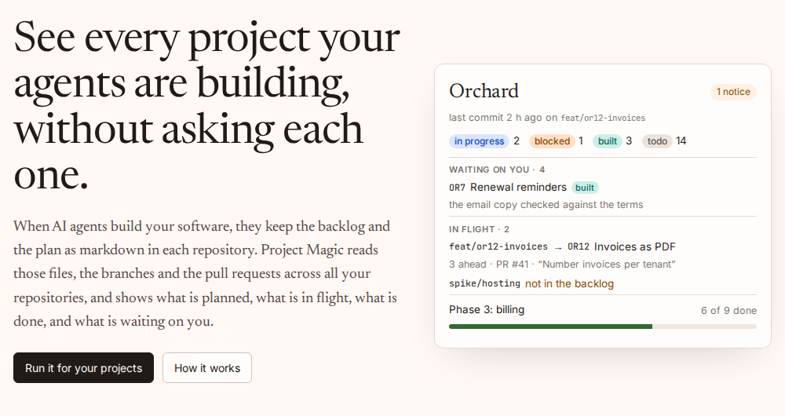

# Project Magic

**See every project your AI agents are building, without asking each one.**

When AI coding agents build your software, they keep the backlog and the build plan as markdown
in each repository. Project Magic reads those files, the branches and the pull requests across
all your repositories, and shows what is planned, what is in flight, what is done, and what is
waiting on you. When you need to change something, an edit made in Project Magic is an ordinary
commit to the backlog, made as you.



- **One place for every project.** A card per repository: what is in progress and on which
  branch, what is in review, what is blocked and why, the plan's progress and its next task.
- **What is waiting on you.** Items that are *built* (merged, waiting on a person's acceptance
  check) or *blocked* carry what they wait on, so your own queue is on the front page.
- **The files stay the record.** Status is derived from the backlog, the plan, branches and pull
  requests. Nothing is kept anywhere else, and agents and people read the same files.
- **Per project:** the backlog as a list in priority order, a board, the plan, what has shipped
  (found from git history), every branch with what it is working on, and the documents.
- **Editing:** change an item, add one, drag to reorder, remove one. Each edit is a commit on a
  `projectmagic` branch whose pull request is merged straight away, so main is never behind.

It runs on your own accounts: a GitHub App, a Postgres database and a host for a SvelteKit app.
[Setting up](#setting-up) takes under an hour.

**Status:** v0.1, in use by its author on two projects. It is built for one person or a small
team; the roles and permissions exist, but inviting people is not built yet
([`backlog.md`](backlog.md), PM7).

## Contents

- [How it works](#how-it-works)
- [The conventions](#the-conventions)
- [Setting up](#setting-up)
- [Adding a repository](#adding-a-repository)
- [Developing](#developing)
- [Where things are](#where-things-are)
- [Licence](#licence)

## How it works

1. **The agents in each repository follow a few conventions** (below): every backlog item is a
   `###` heading that starts with an id and has a status line under it, branches name the item
   they work on, and pull requests say what they build.
2. **A GitHub App reads the repositories** it is installed on. A push or a pull request reaches
   Project Magic by webhook within seconds, and a sync fetches the branches, their pull requests
   and the tracked files in two GraphQL calls, parsing only files it hasn't seen before. A daily
   cron re-syncs everything in case a webhook was missed.
3. **Status is derived, in order** (`spec.md` §7.2): an item removed from main's backlog, or
   marked `done`, is done; one with an open pull request is in review; one marked todo or
   blocked that has an active branch is in progress; otherwise its status line says. When the
   backlog and the plan disagree, the disagreement is shown, never resolved for you.
4. **Edits go through git.** Project Magic commits the change to a branch named `projectmagic`
   with your own GitHub token, opens a pull request, and squash-merges it. If the merge is
   refused (a review is required, say), the pull request stays open and the edit shows as
   pending.

[`spec.md`](spec.md) is the full specification, and
[`docs/architecture.md`](docs/architecture.md) draws the system as three C4 diagrams.

## The conventions

Paste the block in [`specs/conventions.md`](specs/conventions.md) into each repository's
`CLAUDE.md` or `AGENTS.md`. In short:

```markdown
### OR12 Invoices as PDF — MONEY
**Status:** in progress · **Size:** M · **Branch:** `feat/or12-invoices` · **Plan:** 3.4

Why it matters, what is decided, what is left.
```

- **Items** are `###` headings starting with an id: letters and a number (`OR12`, `A1a`), or a
  plan task's number (`3.4`). Ids are never reused. `##` headings are sections, and order is
  priority. A heading without an id is a note.
- **The status line** comes first under the heading and begins with `**Status:**`: `todo`,
  `in progress`, `blocked`, `in review`, `built` or `done`. `Waiting:` says what a blocked or
  built item waits on; `Branch:`, `Plan:` and `Size:` are optional.
- **Branches** are named `<type>/<ref>-<slug>`, such as `feat/or12-invoices`, and are pushed as
  soon as work starts.
- **Pull requests** say `Backlog: OR12` and/or `Plan: 3.4` in their description.
- **The plan** (`PROGRESS.md`, optional) is any table whose first column is `#` and that has a
  `Status` column whose cells begin with `done`, `todo`, `in progress`, `blocked`, `built` or
  `skipped`.
- **The branch name `projectmagic`** is reserved for Project Magic's edits.

An existing backlog can be migrated in one pass; `specs/conventions.md` has a checklist.

## Setting up

You need:

- **Node.js 24** and npm, to build and to run it locally;
- **a GitHub account**, to own the GitHub App;
- **a Postgres database**: [Neon](https://neon.tech)'s free tier is enough, and its pooled
  connection string is what the app expects;
- **a host for a SvelteKit app**: it is configured for [Vercel](https://vercel.com) (the
  webhook needs a public URL, and the daily sync uses Vercel Cron).

### 1. Get the code

```sh
git clone https://github.com/nickwhiteley/projectmagic.git
cd projectmagic
npm ci
cp .env.example .env
```

### 2. Register a GitHub App

GitHub → **Settings → Developer settings → GitHub Apps → New GitHub App**:

| Setting | Value |
| ------- | ----- |
| Name | anything unique on GitHub, such as `Project Magic (yourname)` |
| Homepage URL | your deployment's URL, or this repository's |
| Callback URLs | `http://localhost:5173/auth/github/callback`, and `https://<your-domain>/auth/github/callback` once deployed |
| Expire user authorization tokens | **on** (sign-in returns a refresh token, stored encrypted) |
| Request user authorization (OAuth) during installation | off |
| Enable Device Flow | off |
| Setup URL | `https://<your-domain>/tenant/installations/setup`, with **Redirect on update** on: GitHub sends people back here after they install, and the tenant claims the installation |
| Webhook | **active** once deployed: `https://<your-domain>/api/github/webhook`, with a secret from `openssl rand -hex 32`. Leave it inactive until then |
| Repository permissions | **Contents:** read and write · **Pull requests:** read and write · **Metadata:** read-only · **Deployments** and **Actions:** read-only (for the delivery measures planned in PM9) |
| Account permissions | none |
| Subscribe to events | **Push**, **Pull request**, **Create**, **Delete** (GitHub always sends the installation events to an App, so there is nothing to tick for them) |
| Where can it be installed | only on this account |

Then, on the App's page:

1. note the **App ID** and **Client ID**;
2. **generate a client secret**;
3. **generate a private key** (a `.pem` file downloads; keep it out of the repository);
4. note the App's URL name (`github.com/apps/<name>`), which is `GITHUB_APP_SLUG`.

You install the App from Project Magic itself, in step 6: *Tenant → Installations → Connect GitHub*.

### 3. Fill in the environment

`.env.example` lists every variable, and `src/env.ts` checks them when the app starts:

| Variable | What |
| -------- | ---- |
| `DATABASE_URL` | the Postgres connection string (Neon's pooled one) |
| `GITHUB_APP_ID`, `GITHUB_CLIENT_ID`, `GITHUB_CLIENT_SECRET` | from the App's page |
| `GITHUB_APP_PRIVATE_KEY_PATH` | locally, the path to the `.pem` |
| `GITHUB_APP_PRIVATE_KEY` | when deployed, the `.pem`'s contents |
| `GITHUB_WEBHOOK_SECRET` | the webhook secret (`openssl rand -hex 32`) |
| `SESSION_SECRET` | signs the session cookie (`openssl rand -hex 32`) |
| `TOKEN_ENCRYPTION_KEY` | encrypts users' refresh tokens (`openssl rand -base64 32`) |
| `GITHUB_APP_SLUG` | the App's URL name, for the *Connect GitHub* link |
| `BOOTSTRAP_ADMIN_GITHUB_LOGIN` | your GitHub login: the first person to sign in with it becomes the platform administrator, and creates the tenant |
| `BILLING_PROVIDER`, `BILLING_STUB` | optional: leave unset and billing is off (a self-hosted copy). `stub` takes no money, for trying tiers; on a production deploy it also needs `BILLING_STUB` |
| `CRON_SECRET` | protects the daily sync; Vercel sends it, so set the same value there |
| `INFERENCE_PROVIDER`, `INFERENCE_MODEL`, `INFERENCE_BASE_URL`, `INFERENCE_API_KEY`, `INFERENCE_DAILY_TOKEN_LIMIT` | optional: a model (`ollama`, `openai` or `anthropic`) that proposes a status for items with no meta line, shown as *inferred*. Local Ollama needs `INFERENCE_BASE_URL`; Ollama cloud needs only `INFERENCE_API_KEY` (the address defaults to `https://ollama.com`); the others need `INFERENCE_API_KEY`. Unset, it is off. Each tenant may use 50 000 tokens a day unless you set a limit |

### 4. Create the tables and run it

```sh
make migrate   # creates the tables (migrations/*.sql), once per database; run again after an update
make sync      # first sync of every installed repository; the first can take a minute
make dev       # http://localhost:5173
```

Sign in with GitHub. Only accounts with a user record can sign in, and the first is the one in
`BOOTSTRAP_ADMIN_GITHUB_LOGIN`.

### 5. Deploy

On Vercel:

1. **Import** the repository as a new project. SvelteKit is detected and the Vercel adapter is
   configured; keep the default build settings.
2. **Add the environment variables** for Production (and Preview, if you use it). Use
   `GITHUB_APP_PRIVATE_KEY` with the key's contents rather than the path, and set `CRON_SECRET`.
3. **Deploy**, and add your domain if you have one.
4. **Back on the GitHub App:** add the deployed callback URL, then make the webhook active with
   the deployed URL and the secret, and check the four events are still ticked.

To check it: GitHub's *Advanced* tab on the App lists each webhook delivery and its response
(202 for a push), and the project's *synced* time on the overview should change within seconds
of a push. Without a webhook, page loads, the *Refresh* button and the daily cron still sync.

### 6. Create your tenant and connect GitHub

Sign in with the `BOOTSTRAP_ADMIN_GITHUB_LOGIN` account. You land on *Welcome*: create your tenant,
then *Connect GitHub* sends you to GitHub to install the App on an account and choose its
repositories. Sign-up is closed by default, so nobody else can create a tenant; *Admin → Settings*
changes that for a hosted service (`specs/tenants.md`).

## Adding a repository

1. **Install the GitHub App** on it (*Tenant → Installations → Connect GitHub*, or the App's page →
   *Configure* for an account already connected). It appears on the overview after the next sync.
2. **Add the conventions** to its agent instructions and, if it has a backlog already, migrate it
   (`specs/conventions.md`).
3. **Optionally, add `.projectmagic.yml`** at its root. Every key has a default:

   ```yaml
   name: Orchard              # shown in Project Magic; default: the repository's name
   backlog: backlog.md        # default: backlog.md, then BACKLOG.md
   progress: PROGRESS.md      # the plan; null if there isn't one
   epics: epics.md            # epics with descriptions and targets (optional)
   bugs: bugs.md              # a second backlog for bugs (optional); new ones are BUG12
   docs:                      # documents shown in the Docs tab
     - README.md
     - spec.md
     - specs/**/*.md
   docs_exclude:
     - specs/archive/**
   new_id_prefix: OR          # suggested for new items; default: the most common prefix
   active_branch_days: 30     # a branch with no commit for longer is stale
   auto_merge: true           # merge each edit's pull request straight away
   batch_edits: true          # false saves every edit at once; true lets people hold edits and save them as one commit (needs migration 005)
   inference: true            # false opts out of model-inferred statuses (needs INFERENCE_PROVIDER)
   ```

4. **Optionally, keep your workflows off Project Magic's edits**, which come from the branch
   `projectmagic` and only touch `backlog.md`: add `if: github.head_ref != 'projectmagic'` to
   jobs that run on pull requests, and `paths-ignore: [backlog.md]` to push triggers
   (`spec.md` §10.4).
5. **Optionally, keep Vercel from deploying them**: add to the repository's `vercel.json`

   ```json
   "git": { "deploymentEnabled": { "projectmagic": false } },
   "ignoreCommand": "git diff --quiet HEAD^ HEAD -- ':(top)' ':(top,exclude)backlog.md'"
   ```

   The first skips the `projectmagic` branch's previews; the second skips any push to main that
   only changes `backlog.md`, such as a merged edit.

## Developing

```sh
make dev        # the dev server
make test       # unit tests, type check and lint
make test-e2e   # Playwright
make build      # a production build
```

SvelteKit 3 with Svelte 5 and TypeScript, Vitest and Playwright, Postgres through `postgres`, and
the markdown parsed with remark. The unit tests run against real backlogs and plans, frozen in
`test/fixtures/`, and pin their parse in `test/golden/`.

## Where things are

| Path | What |
| ---- | ---- |
| [`spec.md`](spec.md) | the specification: conventions, linking, sync, status, editing, auth |
| [`docs/architecture.md`](docs/architecture.md) | the architecture as C4 diagrams: context, containers, components |
| [`PROGRESS.md`](PROGRESS.md) | the build plan and its status, phase by phase |
| [`backlog.md`](backlog.md) | what comes next, written to the conventions so Project Magic reads it too |
| [`specs/conventions.md`](specs/conventions.md) | the block for each repository's agent instructions |
| `src/lib/core/` | the pure core, no I/O: parsing, linking, status, history, editing, access |
| `src/lib/server/` | GitHub, the sync, the database, sign-in and the write path |
| `src/routes/` | pages and endpoints; `src/lib/server/routes.ts` says what each requires |
| `migrations/` | the database schema |
| `design/` | the visual design and what to keep from it |
| `spikes/` | the experiments that settled the GraphQL fetch and the splicing |

## Licence

[MIT](LICENSE). Copyright (c) 2026 Nick Whiteley.
